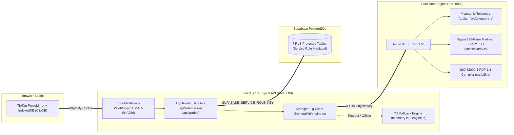

<div align="center">
  

  <h1>Clio</h1>
  <p><strong>Proof-of-Write Academic Authorship, Keystroke Telemetry &amp; Session Replay Platform</strong></p>
  <p><em>Verify how an essay was written—not what a probabilistic classifier guesses after the fact.</em></p>
</div>

<div align="center">

[](./engine-rust)
[](./frontend)
[](./migrations)
[](./engine-rust/tests)
[](./auto_qa_tests)
[](./LICENSE)

[**Architecture Reference**](docs/architecture.md) · [**System QA & Verification Ledger**](docs/clio_system_qa_documentation.md) · [**Working System & Release Report**](docs/github_release_and_architecture_report.md) · [**FERPA & Security Standards**](docs/security_and_compliance.md)

</div>

---

## Why Clio Exists

At `t = 41,200ms`, a 1,400-word essay on the CAP theorem lands inside a browser editor in a single `180ms` DOM transaction. Ten minutes later, another student submits the same assignment after 41 monotonic ProseMirror snapshots recorded at `65 WPM`, complete with mid-sentence revisions and a four-minute pause between paragraphs.

Post-hoc "AI text detectors" regularly get both wrong—passing paraphrased copy-pastes while flagging non-native English writers for writing with formal syntax.

**Clio replaces post-hoc guessing with deterministic Proof-of-Write.** Students draft inside a distraction-free **TipTap ProseMirror** studio that captures time-compressed session snapshots (`IndexedDB` + cloud sync). On submission, a dedicated **Pure Rust Compute Engine (`engine-rust/`)** verifies timestamp monotonicity, isolates rapid paste bursts (`>15 chars` in `<300ms` or `>=50 chars` in `<=2000ms`), cross-checks cohort collusion via **128-permutation MinHash + 64×2 Locality-Sensitive Hashing (LSH)** on **Rayon** worker threads, and gives instructors a frame-by-frame **Session Replay** of how the work came together.

---

## What Clio Refuses to Do (Design Trade-Offs)

1. **No Webcam Proctoring or Keylogger Spyware**: Clio never accesses the camera, microphone, or OS clipboard outside the editor canvas. It records periodic document-state snapshots (`timestamp`, `textLength`, subsampled `html`), not raw character-by-character keycodes.
2. **No Black-Box "AI Probability%" Verdicts**: Clio outputs verifiable physical signals—active typing cadence (with pauses `>5s` compressed), discrete paste events, and exact shingle collisions—so an honest student can prove authorship using their own replay timeline.
3. **Zero Single-Point-of-Failure on the Compute Engine**: The Next.js backend talks to `engine-rust` (`127.0.0.1:8088`) through a **Strangler Fig proxy** ([`frontend/lib/engine.ts`](frontend/lib/engine.ts)). If you kill the Rust process mid-request, an `AbortSignal.timeout` guard (`3000ms` telemetry / `5000ms` similarity) catches the fault and falls back to local TypeScript engines with zero student data loss.

---

## System Architecture



### Core Engineering Subsystems

| Subsystem | Implementation | Technical Guarantees |
| :--- | :--- | :--- |
| **Telemetry Auditor** | [`engine-rust/src/telemetry.rs`](engine-rust/src/telemetry.rs) & [`frontend/lib/telemetry.ts`](frontend/lib/telemetry.ts) | Enforces strictly increasing timestamps (`t[i] > t[i-1]`), flags fast paste jumps (`>15 chars` in `<300ms`), detects untracked trailing DOM injection, and caps stored HTML snapshots at ≤ 200 (`≤ 50,000 chars` / `~50 KB` each). |
| **MinHash + LSH Similarity** | [`engine-rust/src/similarity.rs`](engine-rust/src/similarity.rs) & [`frontend/lib/engine.ts`](frontend/lib/engine.ts) | Normalizes Unicode & HTML entities, extracts 4-word shingles, computes 128 64-bit FNV-1a/Weyl-mixed hashes in parallel via `rayon::prelude::*`, and buckets signatures into `64 bands × 2 rows` (with exact pairwise evaluation for cohorts ≤ 60). |
| **Zero-Chromium PDF Compiler** | [`engine-rust/src/pdf.rs`](engine-rust/src/pdf.rs) | Compiles HTML headings, paragraphs, and lists directly into binary PDF 1.4 documents in memory across A4 pages (`595.28 × 841.89 pt`) with strict 20-byte ISO 32000-1 `xref` records (`{off:010} 00000 n \n`) and a 100-page ceiling. |
| **Edge RBAC & Auth Hardening** | [`frontend/middleware.ts`](frontend/middleware.ts) & [`frontend/lib/auth.ts`](frontend/lib/auth.ts) | Validates `exp`, `iat`, and `jti` token claims via `crypto.subtle` at the Edge; neutralizes login username enumeration with constant-time dummy `bcrypt` hashing; gates teacher signups via `crypto.timingSafeEqual`. |
| **DOCX-to-PDF SSRF Sandbox** | [`frontend/app/api/convert-docx-to-pdf/route.ts`](frontend/app/api/convert-docx-to-pdf/route.ts) | Scrubs HTML via `sanitize-html` (stripping `<script>`, `<iframe>`, and remote CSS `url()`), enforces a 25 MB upload limit, routes to the Rust PDF engine first, and aborts all `http:`, `https:`, `file:`, `ftp:`, `ws:`, `wss:`, and `javascript:` network requests on fallback. |

---

## Multi-Role Workflows (Student, Teacher, Admin)

### 🎓 Student Studio (`/editor`, `/student-dashboard`, `/drafts`)
- **TipTap ProseMirror Writing Canvas**: Distraction-free formatting, live word counter, and **Focus Mode** chrome isolation.
- **Dual-Tier Persistence**: 1000ms debounced autosave to browser `IndexedDB` (`ClioDB`) paired with cloud draft synchronization (`/api/drafts`).
- **Live Integrity Telemetry**: Real-time WPM cadence and snapshot capture that protects students with verifiable drafting history.
- **Instant Document Export**: Native PDF and DOCX export directly from the editor.

### 👨‍🏫 Teacher Assessment Suite (`/dashboard`, `/similarity`, `/assignments`, `/classes`)
- **Interactive Session Replay**: Scrub through a student's drafting timeline with time-compressed playback (`>5s` idle pauses compressed to `1s`).
- **Cohort Similarity Matrix**: Side-by-side diff inspection powered by the Rust MinHash/LSH engine.
- **Rubric & Batch Grading**: Score across four weighted rubric dimensions (`Content`, `Grammar`, `Structure`, `Originality`) or batch-grade submissions with ownership-verified IDOR guards.
- **Formula-Safe CSV Export**: Download class gradebooks with automatic neutralization of spreadsheet formula injection vectors (`=`, `+`, `-`, `@`, `|`).

### 🛡️ System Administrator (`/admin`, `/api/admin/users`, `/api/admin/submissions`)
- **Institution-Wide Oversight**: Audit registered student/faculty directories, inspect global submission integrity distributions, and verify system health and atomic JSON telemetry counters (`/health`, `/metrics`).

---

## Quickstart & Local Setup

### Prerequisites
- **Node.js** `v22.0+` and `npm`
- **Rust & Cargo** `1.85+` (optional for local dev due to automatic TypeScript fallback; required for the Pure Rust Compute Engine)
- **Supabase Project** (PostgreSQL database)

### 1. Clone & Install
```bash
git clone https://github.com/yashh1323/Clio.git
cd Clio/frontend
npm install
```

### 2. Configure Environment Variables
Copy the template in [`frontend/.env.example`](frontend/.env.example) to `frontend/.env.local`:
```bash
cp .env.example .env.local
```
Fill in your credentials in `frontend/.env.local`:
```env
# Required: Supabase PostgreSQL Connection
NEXT_PUBLIC_SUPABASE_URL=https://<your-project-id>.supabase.co
NEXT_PUBLIC_SUPABASE_ANON_KEY=<your-supabase-anon-key>
SUPABASE_SERVICE_ROLE_KEY=<your-supabase-service-role-key>

# Required in Production: Cryptographic Session & Faculty Registration Gate
AUTH_SECRET=replace_with_64_char_cryptographic_random_hex_secret
TEACHER_INVITE_CODE=replace_with_institutional_faculty_invite_code

# Optional: Pure Rust Compute Engine (auto-falls back to local TS if unset/offline)
CLIO_ENGINE_URL=http://127.0.0.1:8088
CLIO_ENGINE_KEY=replace_with_shared_hmac_engine_key
```

### 3. Initialize the PostgreSQL Schema
Run [`migrations/000_full_schema.sql`](migrations/000_full_schema.sql) in your Supabase SQL Editor. This provisions all 7 RLS-enabled tables (`profiles`, `assignments`, `classes`, `class_enrollments`, `submissions`, `grades`, `drafts`) and 10 indexes.

### 4. Start Clio

**Option A — One-Click Windows Launcher (Rust Engine + Next.js):**
```cmd
start-clio.bat
```

**Option B — Manual Dual-Terminal Startup:**
```bash
# Terminal 1: Start the Rust Compute Engine on http://127.0.0.1:8088
cd engine-rust
cargo run --release

# Terminal 2: Start Next.js 16 on http://localhost:3000
cd frontend
npm run dev
```

**Option C — Docker Compose (Production Containers):**
```bash
docker compose up --build
```

---

## Verification & Test Suites

Every security boundary, algorithm, and role workflow is backed by automated verification scripts:

```bash
# 1. Run Pure Rust Engine Unit & Integration Tests (40/40 tests + Clippy lints)
cd engine-rust
cargo test
cargo clippy --all-targets -- -D warnings

# 2. Run Frontend Security, Telemetry, Strangler Fig & Hardening Suites (38/38 assertions)
cd ../frontend
npm test

# 3. Run Live Multi-Role Classroom & Admin E2E Verification against Supabase
node test_live_classroom_e2e.mjs
node test_live_admin_e2e.mjs

# 4. Run 5-Layer Auto-QA Playwright Suite (requires dev server on :3000 and Rust engine on :8088)
cd ..
node auto_qa_tests/run_full_5layer_verification.mjs
```

---

## Repository Structure

```text
Clio/
├── engine-rust/                  # Pure Rust Compute Microservice (Axum + Tokio + Rayon)
│   ├── src/
│   │   ├── api.rs                # REST handlers (/health, /metrics, /api/v1/*) & CORS/Auth guards
│   │   ├── telemetry.rs          # Zero-copy keystroke monotonicity & paste-burst auditor
│   │   ├── similarity.rs         # Parallel 128-perm MinHash + 64x2 LSH similarity engine
│   │   ├── pdf.rs                # Native in-process ISO 32000-1 PDF 1.4 compiler
│   │   └── main.rs               # Tokio runtime entrypoint (127.0.0.1:8088)
│   └── tests/
│       └── integration_test.rs   # Full HTTP pipeline & security header integration tests
├── frontend/                     # Next.js 16 (App Router) Web Studio & API Tier
│   ├── app/                      # Student Editor, Teacher Dashboard, Similarity & API Routes
│   ├── lib/
│   │   ├── auth.ts               # HMAC-SHA256 token signing & timing-safe verification
│   │   ├── engine.ts             # Strangler Fig proxy client + local similarity fallback
│   │   ├── telemetry.ts          # Local TypeScript keystroke telemetry auditor fallback
│   │   └── supabase.ts           # Isolated Anon & Service Role Supabase clients
│   ├── middleware.ts             # Edge WebCrypto session & RBAC guard
│   ├── .env.example              # Sanitized environment configuration template
│   └── test_*.mjs                # Automated security & live E2E verification suites
├── migrations/                   # PostgreSQL DDL & Row Level Security (RLS) migrations
│   ├── 000_full_schema.sql       # Complete 7-table schema, foreign keys, indexes & RLS
│   └── 002_lockdown_rls_all_tables.sql
├── auto_qa_tests/                # 5-Layer Declarative TestSprite Plans & Playwright Specs
├── docs/                         # Architecture, Security Compliance, QA & Release Reports
├── docker-compose.yml            # Multi-container orchestration (frontend + engine-rust)
└── start-clio.bat                # Windows unified launcher
```

---

## Contributing & License

Contributions, bug reports, and security audits are welcome. Please review [CONTRIBUTING.md](CONTRIBUTING.md), [CODE_OF_CONDUCT.md](CODE_OF_CONDUCT.md), and [SECURITY.md](SECURITY.md) before opening a pull request. Licensed under the [MIT License](LICENSE).
