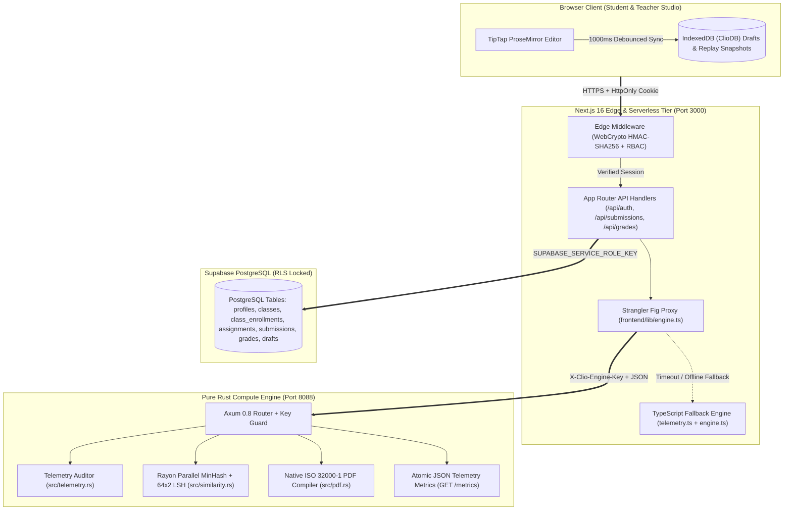

# Clio: System Architecture & Technical Reference

This document details the production architecture, inter-process contracts, security boundaries, and data models of **Clio** ([`frontend/`](../frontend) + [`engine-rust/`](../engine-rust)).

---

## 1. High-Level System Topology

Clio uses a **Hybrid Strangler-Fig Architecture** that pairs a Next.js 16 App Router application with a dedicated, memory-safe **Pure Rust Compute Engine ([`engine-rust/`](../engine-rust))** and **Supabase PostgreSQL** with Row Level Security (RLS).

| Layer | Technology | Responsibility |
| :--- | :--- | :--- |
| **Edge Gatekeeper** | Next.js 16 Edge Middleware ([`frontend/middleware.ts`](../frontend/middleware.ts)) | Validates `clio_session` WebCrypto `HMAC-SHA256` signatures, enforces `exp`/`iat`/`jti` claims, and blocks unauthorized role routing (`401`/`403`) before serverless execution. |
| **Web & API Tier** | Next.js 16.0.10, React 19, TypeScript | Renders the TipTap ProseMirror writing studio, teacher grading dashboard, and orchestrates CRUD mutations against Supabase using an isolated Service Role client ([`frontend/lib/supabase.ts`](../frontend/lib/supabase.ts)). |
| **Compute Engine** | Rust 2024 (`Axum 0.8` + `Tokio 1.54` + `Rayon 1.12`) | Executes zero-copy keystroke telemetry monotonicity audits, data-parallel 128-permutation MinHash + 64×2 LSH similarity detection, and native ISO 32000-1 PDF 1.4 compilation on port `8088`. |
| **Resilience Proxy** | Strangler Fig Client ([`frontend/lib/engine.ts`](../frontend/lib/engine.ts)) | Routes compute workloads to `engine-rust` with pre-shared `X-Clio-Engine-Key` authentication and automatic `AbortSignal.timeout` recovery (`2s`/`3s`/`5s`) to local TypeScript engines if unreachable. |
| **Persistence Tier** | Supabase PostgreSQL + Browser `IndexedDB` | Stores relational academic records under strict RLS policies on the server while maintaining dual-tier offline draft & snapshot durability (`ClioDB`) in the browser. |

---

## 2. Architecture & Data Flow Diagram

---

## 3. Core Compute Subsystems ([`engine-rust/`](../engine-rust))

### 3.1 "Proof of Write" Keystroke Telemetry Auditor ([`engine-rust/src/telemetry.rs`](../engine-rust/src/telemetry.rs))
Rather than relying on post-hoc AI text classifiers that suffer from high false-positive rates on non-native English writers, Clio verifies **how the document was constructed**:
1. **Client-Side Capture & Compression**: The editor records periodic `ReplaySnapshot` events (`timestamp`, `textLength`, subsampled `html`). Idle pauses `>5000 ms` are compressed to `1000 ms` to preserve active typing cadence.
2. **Snapshot Subsampling Bound**: Both client and server enforce a ceiling of `≤ 200` full HTML snapshots (`≤ 50,000 chars` / `~50 KB` per snapshot) and `≤ 10,000` total metadata points to prevent payload amplification.
3. **Server-Side Monotonicity & Paste Verification**:
   - Rejects non-monotonic (duplicate or backwards) timestamps as tampered telemetry.
   - Flags rapid character bursts (`>15 chars` in `<300 ms`) and large block inserts (`≥ 50 chars` in `≤ 2000 ms`) as discrete paste events.
   - Detects untracked trailing content injection when the final submitted document length diverges from the final telemetry snapshot.
   - Computes verified active WPM and a deterministic `integrityScore` (`0–100`).

### 3.2 Parallel MinHash & LSH Similarity Engine ([`engine-rust/src/similarity.rs`](../engine-rust/src/similarity.rs))
Cross-checking $N$ student essays with naive pairwise string comparison scales at $O(N^2 \cdot L)$. Clio's Rust engine reduces candidate discovery to near-linear time for large cohorts while preserving exact recall for smaller classes:
1. **Text Normalization & Shingling**: Strips HTML tags, decodes entities, normalizes Unicode, and extracts overlapping 4-word shingles.
2. **128-Permutation MinHash Signatures**: Computes 128 independent 64-bit FNV-1a shingle hashes mixed with SplitMix64/MurmurHash3-style `mix64` over 128 Weyl-sequence seeds in parallel across submissions using **Rayon** (`par_iter`).
3. **Locality-Sensitive Hashing (LSH)**: For cohorts of `≤ 60` submissions per assignment, evaluates all pairs directly for 100% recall; for larger cohorts (`> 60`), partitions the 128-hash signature into `64 bands × 2 rows` and evaluates exact Jaccard shingle similarity across colliding bucket candidates. When `engine-rust` is unreachable, [`frontend/lib/engine.ts`](../frontend/lib/engine.ts) falls back to `localAnalyzeSimilarity` (4-word shingle Jaccard comparison).

### 3.3 Native In-Process ISO 32000-1 PDF Compiler ([`engine-rust/src/pdf.rs`](../engine-rust/src/pdf.rs))
To eliminate the memory overhead and Server-Side Request Forgery (SSRF) surface of headless Chromium for routine essay exports:
- Parses structured HTML headings (`<h1>`–`<h3>`), paragraphs, and lists into wrapped typographic lines.
- Paginates content across standard A4 pages (`595.28 × 841.89 pt`) with a strict 100-page ceiling (`MAX_PDF_PAGES = 100`).
- Emits raw PDF 1.4 binary objects with strictly formatted 20-byte `xref` offset records (`{off:010} 00000 n \n`).
- For legacy `.docx` uploads ([`frontend/app/api/convert-docx-to-pdf/route.ts`](../frontend/app/api/convert-docx-to-pdf/route.ts)), Mammoth HTML output is scrubbed via `sanitize-html` and routed first to the Rust PDF engine; if falling back to headless rendering, request interception unconditionally aborts all `http:`, `https:`, `file:`, `ftp:`, `ws:`, `wss:`, and `javascript:` network schemes (blocking all external hosts and RFC 1918 private networks alike).

---

## 4. Relational Database Schema ([`migrations/000_full_schema.sql`](../migrations/000_full_schema.sql))

All seven tables reside in the `public` schema with **Row Level Security (RLS)** enabled and anonymous direct table access revoked ([`migrations/002_lockdown_rls_all_tables.sql`](../migrations/002_lockdown_rls_all_tables.sql)):

- **`profiles`**: `id (UUID PK)`, `username (UNIQUE)`, `email`, `password (bcrypt)`, `role ('student' | 'teacher' | 'admin')`, `full_name`, `course`, `class`, `student_class`.
- **`assignments`**: `id (UUID PK)`, `teacher_id (FK -> profiles.id)`, `title`, `description`, `due_date`.
- **`classes`**: `id (UUID PK)`, `teacher_id (FK -> profiles.id)`, `name`, `description`.
- **`class_enrollments`**: `id (UUID PK)`, `class_id (FK -> classes.id)`, `student_id (FK -> profiles.id)`, `UNIQUE(class_id, student_id)`.
- **`submissions`**: `id (UUID PK)`, `student_id (FK -> profiles.id)`, `teacher_id (FK -> profiles.id)`, `assignment_id (FK -> assignments.id)`, `assignment_title`, `content`, `wpm`, `paste_count`, `integrity_score`, `replay_snapshots (JSONB)`.
- **`grades`**: `id (UUID PK)`, `submission_id (UNIQUE FK -> submissions.id)`, `teacher_id (FK -> profiles.id)`, `score (0..100)`, `feedback`.
- **`drafts`**: `id (UUID PK)`, `student_id (FK -> profiles.id)`, `assignment_id (FK -> assignments.id)`, `title`, `content`, `html`, `json_content (JSONB)`, `word_count`, `last_saved_at`, `created_at`, `updated_at`.

---

## 5. Defense-in-Depth Security Controls

1. **Cryptographic Session Tokens ([`frontend/lib/auth.ts`](../frontend/lib/auth.ts))**:
   - Signed with `HMAC-SHA256` using `AUTH_SECRET`.
   - Enforces `exp`, `iat`, and `jti` claims; verified via constant-time `crypto.timingSafeEqual` in Node.js and `crypto.subtle.verify` in Edge Middleware.
2. **Timing-Safe Authentication & Invite Gates**:
   - [`/api/auth/login`](../frontend/app/api/auth/login/route.ts) executes a constant-time dummy `bcrypt` comparison when a username does not exist to prevent account enumeration.
   - [`/api/auth/register`](../frontend/app/api/auth/register/route.ts) validates `TEACHER_INVITE_CODE` via `crypto.timingSafeEqual` before permitting faculty account creation.
   - Dual sliding-window rate limiters (per-IP and per-account) protect authentication and submission endpoints.
3. **Strict Ownership & IDOR Prevention**:
   - [`/api/grades`](../frontend/app/api/grades/route.ts) and [`/api/grades/batch`](../frontend/app/api/grades/batch/route.ts) verify `submission.teacher_id` ownership (bound from the parent assignment at submission time) before writing grades.
   - [`/api/export/grades`](../frontend/app/api/export/grades/route.ts) neutralizes CSV formula injection vectors (`=`, `+`, `-`, `@`, `|`, `\t`, `\r`) with leading single-quote escaping.
4. **Hardened HTTP Response Headers ([`frontend/next.config.ts`](../frontend/next.config.ts))**:
   - Configures `Content-Security-Policy` (compatible with the optional Spotify Web Playback SDK), `X-Frame-Options: DENY`, `X-Content-Type-Options: nosniff`, `Referrer-Policy: strict-origin-when-cross-origin`, and `Permissions-Policy`.
