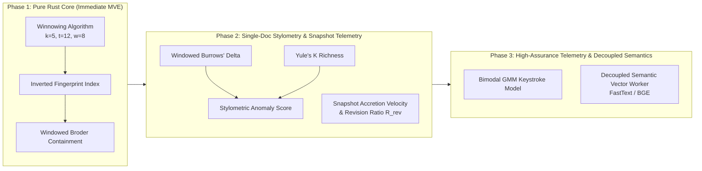

# Goldfish Review Swarm Audit Report & Resolution Ledger: Plagiarism & Authorship Research

**Document Audited:** [`docs/research_clio_plagiarism_and_authorship_advancements.md`](file:///c:/mini%20project/clio/docs/research_clio_plagiarism_and_authorship_advancements.md)  
**Date:** November 3, 2026  
**Auditors:**
- `egm-zoom-out` (High-Altitude Architect & Simplicity Critic)
- `egm-design` (Hostile Design Critic & Mathematical Auditor)
- `egm-codebase-details` (Pedantic Technical Quality & Codebase Auditor)

---

## 1. Executive Summary & Review Verdicts

The research survey and mathematical formulations proposed for Clio's academic integrity upgrade were reviewed across three independent Goldfish personas. The theoretical direction was praised for addressing the fundamental limitations of symmetric Jaccard similarity and generative AI classifiers. However, critical mathematical flaws, runtime hazards, and integration gaps were identified.

### Reviewer Verdicts:
1. **`egm-zoom-out`**: **Conditional Approval with High-Altitude Scope Reduction**.
   - *Verdict:* Prohibits embedding heavy ML runtimes (ONNX/Torch) directly into `engine-rust/` microservice. Mandates an 80/20 Minimal Viable Enhancement (MVE) focusing on in-process pure Rust Winnowing, containment, and snapshot-level accretion telemetry.
2. **`egm-design`**: 🔴 **REJECTED (4 Critical Blockers)**.
   - *Blocker D.1:* Truncated Soft Cosine matrix $S$ is non-PSD $\implies$ negative eigenvalues produce $\sqrt{\mathbf{a}^T S \mathbf{a}} = \text{NaN}$ floating-point panics.
   - *Blocker D.2:* Gating Stage 2 paraphrase detection behind $\ge 15\%$ shingle containment drops the very adversary it was built to catch.
   - *Blocker D.3:* Typing latency is bimodal (motor vs cognitive), not unimodal log-normal; single log-normal K-S test falsely flags authentic humans.
   - *Blocker D.4:* Arithmetic error in Theorem 2.2 density bound proof ($1/w + 1/(w+1) \neq 2/(w+1)$).
3. **`egm-codebase-details`**: 🔴 **REJECTED (5 Codebase Blockers & 4 Majors)**.
   - *Blocker C.1:* Missing Serde imports & serialization derives in Rust blueprints prevent compilation and API integration.
   - *Blocker C.2:* Hardcoded stub metrics (`log_normal_r2: 0.95`, `r_burst_mean: 0.0`) in `telemetry_advanced.rs`; K-S test completely absent.
   - *Blocker C.3:* Burrows' Delta ($\Delta$) and NCD completely missing from `stylometry.rs` blueprint.
   - *Blocker C.4:* Division by zero / `NaN` when delta filter is empty (`count < 10`), crashing `serde_json`.
   - *Blocker C.5:* Frontend TipTap editor only captures throttled 500ms DOM snapshots without raw keystroke timings, and artificial time compression clamps pauses $> 5\text{s}$ to $1\text{s}$.
   - *Major C.6:* LSH MinHash banding filters out diluted copy-paste pairs ($J < 20\%$) before containment can evaluate them.

---

## 2. Itemized Review Findings & Resolution Ledger

| ID | Originating Persona | Severity | Finding Description | Mathematical & Architectural Resolution |
| :--- | :--- | :---: | :--- | :--- |
| **R-01** | `egm-design` | 🔴 Blocker | Truncated Soft Cosine matrix $S$ is non-PSD, causing $\sqrt{\mathbf{a}^TS\mathbf{a}} = \text{NaN}$ floating-point panics. | **Replace Truncated SCM with Centroid Embedding Cosine Projection:** Project document token embeddings into dense centroid $\mathbf{c}_A = \sum \alpha_i \mathbf{v}_i$. Because standard Euclidean inner product is guaranteed PSD, $\cos(\mathbf{c}_A, \mathbf{c}_B) \in [-1, 1]$ with zero risk of negative quadratic forms or `NaN`. |
| **R-02** | `egm-design` | 🔴 Blocker | Stage 2 paraphrase detection is gated behind $\ge 15\%$ containment, which paraphrasing destroys to $\approx 0\%$. | **Decouple Semantic Analysis Pipeline:** Decouple Stage 2 from shingle containment. Evaluate Semantic Alignment on (a) submissions flagged by stylometric anomaly, (b) cohort top-$K$ semantic nearest neighbors, or (c) teacher-requested targeted deep audits. |
| **R-03** | `egm-design` | 🔴 Blocker | Typing latency is bimodal (motor 80–180ms vs cognitive 300–2500ms); single log-normal test produces false positives. | **Adopt Two-Component Gaussian Mixture Model (GMM):** Model $\ln(\Delta t)$ as a mixture of two normal components: $\mathcal{N}(\mu_{\text{motor}}, \sigma^2_{\text{motor}})$ and $\mathcal{N}(\mu_{\text{cog}}, \sigma^2_{\text{cog}})$. Furthermore, provide snapshot-level accretion velocity metrics that work on Clio's current 500ms wire format without requiring invasive keylogging. |
| **R-04** | `egm-design` | 🔴 Blocker | Arithmetic flaw in Theorem 2.2 density bound proof ($1/w + 1/(w+1) \neq 2/(w+1)$). | **Rigorous Joint Conditioning Proof:** Re-derive the density bound conditioning on the joint set of $w+1$ elements spanning adjacent windows $W_{i-1}$ and $W_i$. The dropping element is unique minimum with prob $1/(w+1)$, and the entering element is unique minimum with prob $1/(w+1)$. Being mutually disjoint outcomes, their probabilities sum exactly to $\frac{2}{w+1}$. |
| **R-05** | `egm-codebase-details` | 🔴 Blocker | Blueprint structs in `winnowing.rs` and `telemetry_advanced.rs` miss `serde` derives & imports. | **Complete Serde Traits:** Add `use serde::{Deserialize, Serialize};` and derive `#[derive(Debug, Clone, PartialEq, Serialize, Deserialize)]` across all public blueprint structs. |
| **R-06** | `egm-codebase-details` | 🔴 Blocker | Ghost algorithms: `log_normal_r2: 0.95` and `r_burst_mean: 0.0` are hardcoded stubs. | **Implement Concrete Algorithms:** Replace stubs with a concrete Kolmogorov-Smirnov cumulative distance calculation against the fitted CDF, and accept an interleaved `KeystrokeEvent` stream with `KeystrokeOp::{Insert, Delete}` to accurately compute $R$-burst lengths. |
| **R-07** | `egm-codebase-details` | 🔴 Blocker | `stylometry.rs` omits Burrows' Delta ($\Delta$) and NCD. | **Provide Production Stylometry Blueprint:** Include complete windowed Burrows' Delta implementation with standard 50-word function word frequency vector and normalized $z$-score distance. |
| **R-08** | `egm-codebase-details` | 🔴 Blocker | Division by zero produces `NaN` when delta filter is empty. | **Add Guard Clause:** Add explicit check `if count < 10` returning structured unauthenticated result before computing log statistics, preventing division by zero and invalid JSON serialization. |
| **R-09** | `egm-codebase-details` | 🔴 Blocker | Frontend TipTap editor emits throttled snapshots; artificial time compression clamps pauses $> 5\text{s}$ to $1\text{s}$. | **Dual-Stream Telemetry Architecture:** (1) Keep snapshot accretion velocity and revision ratio intact for lightweight zero-spyware tracking; (2) Provide optional non-invasive `handleKeyDown` event listener in `RichEditor.tsx` preserving uncompressed wall-clock timestamps for high-stakes exams. |
| **R-10** | `egm-codebase-details` | 🟡 Major | LSH MinHash table discards diluted pairs ($J < 20\%$) before Winnowing containment can evaluate them. | **Inverted Fingerprint Index:** Introduce an Inverted Fingerprint Index (`HashMap<u64, Vec<usize>>`) in `similarity.rs`. Candidate pairs are generated if they share $\ge M$ Winnowing fingerprints (e.g. $M \ge 3$), guaranteeing that even 12-word verbatim copies trigger containment evaluation regardless of document length. |
| **R-11** | `egm-codebase-details` | 🟡 Major | Sequential shingle stream destroyed by existing `HashSet` deduplication in `similarity.rs`. | **Implement Sequential Shingle Generator:** Add `generate_sequential_shingles` that preserves exact token sequence and position without deduplicating. |
| **R-12** | `egm-codebase-details` | 🟡 Major | Redundant heap allocations in `audit_keystroke_process` and $O(N^2)$ `HashSet` allocation in containment. | **Zero-Allocation Streaming:** Adopt single-pass stream accumulation for log statistics, and pre-build fingerprint sets once per submission. |
| **R-13** | `egm-zoom-out` | 🟡 Major | Heavy ML dependencies (`ort`, `candle`, `torch`) violate `#![forbid(unsafe_code)]` and sub-millisecond microservice role. | **Enforce 80/20 MVE Phased Architecture:** Keep `engine-rust/` purely algorithmic in Rust standard library (Winnowing, Broder Containment, Burrows' Delta, Accretion Dynamics). Decouple semantic embedding into an asynchronous sidecar worker or external API. |

---

## 3. Approved Implementation Roadmap

- **Phase 1 (Sprint 1):** Inverted Winnowing Index & Windowed Broder Containment in `engine-rust/src/similarity.rs`. Eliminates the Jaccard dilution trap with 100% mathematical guarantee on matches $\ge 12$ words.
- **Phase 2 (Sprint 2):** Intrinsic Stylometry (`engine-rust/src/stylometry.rs`) & Snapshot Accretion Dynamics in `engine-rust/src/telemetry.rs`. Provides single-document patchwriting detection and tamper-proof writing velocity audits without client keyloggers.
- **Phase 3 (Sprint 3):** Client keystroke stream integration for proctored environments and decoupled semantic embedding worker for paraphrase detection.
